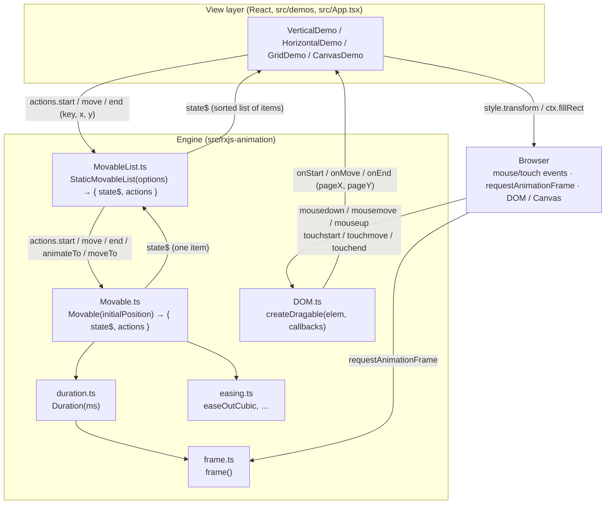

# rxjs-animation-demo — In-Depth Project Explanation

> A step-by-step walkthrough of how this project turns RxJS 6 observables into a
> drag-and-drop, auto-reordering, animated list engine, and how four React demos
> (Vertical, Horizontal, Grid, Canvas) use that engine.

---

## Table of contents

1. [What this project is](#1-what-this-project-is)
2. [Repository layout](#2-repository-layout)
3. [Architecture at a glance](#3-architecture-at-a-glance)
4. [Step-by-step walkthrough](#4-step-by-step-walkthrough)
   - [Step 1 — `frame.ts`: one requestAnimationFrame loop for everyone](#step-1--framets-one-requestanimationframe-loop-for-everyone)
   - [Step 2 — `duration.ts`: time as a 0 → 1 progress stream](#step-2--durationts-time-as-a-0--1-progress-stream)
   - [Step 3 — `easing.ts`: shaping the progress curve](#step-3--easingts-shaping-the-progress-curve)
   - [Step 4 — `DOM.ts`: a unified mouse/touch drag listener](#step-4--domts-a-unified-mousetouch-drag-listener)
   - [Step 5 — `Movable.ts`: the single-item state machine](#step-5--movablets-the-single-item-state-machine)
   - [Step 6 — `MovableList.ts`: composing items into a sortable list](#step-6--movablelistts-composing-items-into-a-sortable-list)
   - [Step 7 — The demos: wiring the engine to React and the DOM](#step-7--the-demos-wiring-the-engine-to-react-and-the-dom)
   - [Step 8 — `App.tsx` and `index.tsx`: the shell](#step-8--apptsx-and-indextsx-the-shell)
5. [End-to-end trace of one drag gesture](#5-end-to-end-trace-of-one-drag-gesture)
6. [RxJS patterns used, and why](#6-rxjs-patterns-used-and-why)
7. [Observations, quirks and potential bugs](#7-observations-quirks-and-potential-bugs)
8. [Running the project](#8-running-the-project)
9. [API quick reference](#9-api-quick-reference)

---

## 1. What this project is

`rxjs-animation-demo` is a small demo repository created in July 2020 by the
GitHub user **lucifier129** (commits are authored as 工业聚 / yj_gu). Its one-line
README says it all: *"A demo for rxjs animation"*.

The project is a **Create React App** (react-scripts 3.4.1) written in
**TypeScript 3.7**, using **React 16.13** and **RxJS 6.6**. It has no
documentation beyond the README and, apart from the easing test added together
with this document, no tests; the `build/` folder is committed on purpose (see
below).

What it demonstrates is a specific idea:

> A draggable, animatable item is a **state machine whose transitions are
> streams**. Pointer gestures, animation frames, easing curves and layout
> re-ordering can all be expressed as a composition of RxJS observables, with
> React reduced to a thin shell that mounts the DOM once.

Concretely, the repo contains:

| Part | Role |
|---|---|
| `src/rxjs-animation/` | A tiny, framework-agnostic animation + drag engine (≈1 250 lines). |
| `src/demos/` | Four React components that use the engine: a vertical list, a horizontal list, a 10-column grid, and the same grid drawn on a `<canvas>`. |
| `src/App.tsx` | A mode switcher that mounts one demo at a time. |
| `src/hooks/useColorList/` | A helper that gives each item a random colour. |

**Why is `build/` committed?** `package.json` sets
`"homepage": "/rxjs-animation-demo/build"`. CRA uses `homepage` to compute
`PUBLIC_URL`, so all asset paths in the built `index.html` start with
`/rxjs-animation-demo/build/static/...`. That is exactly the URL layout you get
when GitHub Pages serves the repository root, so the demo is viewable at
`https://<user>.github.io/rxjs-animation-demo/build/` without a separate
deployment step.

---

## 2. Repository layout

```
rxjs-animation-demo/
├── package.json              CRA 3.4.1, React 16, RxJS 6.6, TS 3.7
├── tsconfig.json             strict, target es5, jsx: react, noEmit
├── public/                   CRA static shell (index.html, manifest, icons)
├── build/                    committed production build (served via GitHub Pages)
└── src/
    ├── index.tsx             ReactDOM.render(<App/>) inside StrictMode        (10 lines)
    ├── App.tsx               mode switcher: Vertical | Horizontal | Grid | Canvas (44 lines)
    ├── react-app-env.d.ts    CRA type reference
    ├── hooks/
    │   └── useColorList/
    │       ├── index.ts      useColorList(n) → [colors, setColors]            (9 lines)
    │       └── colors.ts     getRandomColor() + a palette of ~260 hex colours (267 lines)
    ├── demos/
    │   ├── Vertical.tsx      12 items, random heights, DOM transforms on Y    (101 lines)
    │   ├── Horizontal.tsx    12 items, random widths, DOM transforms on X     (102 lines)
    │   ├── Grid.tsx          100 items, 10 columns, DOM transforms on X and Y (115 lines)
    │   └── Canvas.tsx        100 items, 10 columns, drawn with fillRect       (141 lines)
    └── rxjs-animation/       ← the engine
        ├── frame.ts          shared requestAnimationFrame ticker as an Observable (50 lines)
        ├── duration.ts       Duration(ms): frame() → progress 0..1              (10 lines)
        ├── easing.ts         Robert Penner easing functions (30 of them)        (212 lines)
        ├── easing.test.ts    Jest: f(0)=0, f(1)=1, easeInOut midpoint + continuity (added)
        ├── DOM.ts            createDragable(elem, {onStart,onMove,onEnd})       (72 lines)
        ├── Movable.ts        one draggable/animatable item: {state$, actions}   (314 lines)
        └── MovableList.ts    StaticMovableList: N Movables + layout + reorder   (601 lines)
```

The engine has **no React imports**. Only the `demos/` and `hooks/` folders
depend on React.

---

## 3. Architecture at a glance

The code is layered. Each layer only imports from the layers below it.



Three design decisions shape everything:

1. **Commands in, state out.** Every engine object exposes `actions` (plain
   functions that push into RxJS `Subject`s) and a single `state$` observable.
   This is the Elm/Redux shape, but the reducer is a pipeline of operators rather
   than a `switch` statement.

2. **Relative dragging.** While dragging, the engine never asks "where is the
   pointer?" — it asks "how far did the pointer move since the last event?" and
   adds that delta to the item's own position. The item's position lives in
   layout coordinates (relative to the container); the pointer lives in page
   coordinates. Because only deltas are used, no conversion is needed for the
   movement itself. A conversion (`offset`) is needed only for hit-testing which
   slot the pointer is over.

3. **React does not render animation frames.** React mounts the DOM nodes once.
   Every subsequent frame is applied by a `state$.subscribe(...)` callback that
   writes `style.transform` (or draws on a canvas) directly. This bypasses
   React's reconciliation, which is why 100 animated items stay smooth.

---

## 4. Step-by-step walkthrough

The walkthrough goes bottom-up: from the frame ticker to the demos. Each step
builds on the one before it.

### Step 1 — `frame.ts`: one requestAnimationFrame loop for everyone

`src/rxjs-animation/frame.ts` (50 lines) is the clock of the whole system.

```ts
type SubscribeInfo = { subscriber: Subscriber<number>; startTime: number };

let subscriberInfoList: SubscribeInfo[] = [];   // module-level registry
let isStarted = false;
let requestId = -1;

let tick = () => {
  let list = [...subscriberInfoList];           // snapshot!
  let currentTime = Date.now();
  for (let i = 0; i < list.length; i++) {
    let { subscriber, startTime } = list[i];
    subscriber.next(currentTime - startTime);   // elapsed ms for THIS subscriber
  }
  if (subscriberInfoList.length) {
    requestId = requestAnimationFrame(tick);    // keep going only if someone listens
  }
};

let start = () => {
  if (isStarted) return;                        // idempotent
  isStarted = true;
  requestId = requestAnimationFrame(tick);
};

export const frame = () =>
  new Observable<number>((subscriber) => {
    let subscriberInfo = { subscriber, startTime: Date.now() };
    subscriberInfoList.push(subscriberInfo);
    start();
    return () => {                              // teardown
      let index = subscriberInfoList.indexOf(subscriberInfo);
      if (index !== -1) subscriberInfoList.splice(index, 1);
      if (subscriberInfoList.length === 0) {
        isStarted = false;
        cancelAnimationFrame(requestId);
      }
    };
  });
```

What happens, step by step:

1. `frame()` returns a **cold** `Observable<number>`. Nothing runs until someone
   subscribes.
2. On subscribe, the subscriber is recorded together with its own
   `startTime`. The loop is started if it is not already running.
3. Every animation frame, `tick` emits **elapsed milliseconds since that
   subscriber's own subscription** to each subscriber. Ten animations that
   started at different moments all share one rAF callback but each sees its own
   clock.
4. On unsubscribe, the subscriber is removed. When the last one leaves, the loop
   is cancelled. The whole thing is a reference-counted ticker, like the ticker
   in GSAP or PixiJS, but exposed as an observable.

Two details matter for correctness:

- **The snapshot `[...subscriberInfoList]`.** A subscriber may unsubscribe
  *during* `tick` (this is the normal case: `Duration` completes inside
  `subscriber.next`, which tears down its `frame()` subscription). Iterating a
  copy means removing entries from the real list does not skip anyone.
- **Subscribing during a tick is safe too.** In `MovableList`, a state emission
  triggered by one animation frame can call `animateTo` on other items, which
  subscribes new `frame()` observers while `tick` is running. They are pushed to
  the real list (not the snapshot), `start()` is a no-op because `isStarted` is
  true, and the `if (subscriberInfoList.length)` check at the end schedules the
  next frame, so they get their first value one frame later.

### Step 2 — `duration.ts`: time as a 0 → 1 progress stream

```ts
export function Duration(duration: number) {
  return frame().pipe(
    map((elapsed) => elapsed / duration),   // ms → fraction of the duration
    takeWhile((n) => n <= 1)                // complete once we pass 100 %
  );
}
```

`Duration(500)` is an observable that emits `0.03, 0.06, …, 0.98` (roughly, at
60 fps) and then **completes**. Completion is what makes "animation finished" a
first-class signal: downstream operators can react to `complete` without any
extra bookkeeping.

Note that `takeWhile` is exclusive: the first value above 1 is dropped and the
stream completes, so the last emitted value is usually slightly *below* 1. See
[§7](#7-observations-quirks-and-potential-bugs) for why this is mostly harmless
here and how to fix it.

### Step 3 — `easing.ts`: shaping the progress curve

`easing.ts` is a TypeScript port of Robert Penner's classic easing equations
(BSD licence block at the bottom of the file). Every function has the same
signature:

```ts
(t: number) => number     // t ∈ [0, 1]  →  eased progress, usually ∈ [0, 1]
```

Ten families × three variants = 30 exports:

| Family | `easeIn…` | `easeOut…` | `easeInOut…` |
|---|---|---|---|
| Quad, Cubic, Quart, Quint | polynomial `t^n` | mirrored | split at ½ |
| Sine | `1 − cos(t·π/2)` | `sin(t·π/2)` | cosine blend |
| Expo | `2^(10(t−1))` | `1 − 2^(−10t)` | split |
| Circ | circular arc | circular arc | split |
| Elastic | overshooting sine × exponential decay | | |
| Back | overshoot via `s = 1.70158` | | |
| Bounce | piecewise parabolas (`7.5625` constant) | | |

Because every curve is a plain `(t) => number`, the engine can plug one in with
a single `map(easing)` operator (Step 5). The default everywhere is
`easeOutCubic`, which starts fast and decelerates — the usual choice for "snap
into place" motion.

`Movable.ts` imports the whole module as a namespace (`import * as Easing`) and
derives the type `EasingType = keyof typeof Easing | EasingFn`, so callers can
pass either a name (`"easeOutBounce"`) or their own function.

### Step 4 — `DOM.ts`: a unified mouse/touch drag listener

`createDragable(elem, { onStart, onMove, onEnd })` hides the difference between
mouse and touch and implements the standard "press on element, track on
document" pattern:

```ts
let handleMouseDown = (event: MouseEvent) => {
  let handleMouseMove = (e) => options.onMove(e.pageX, e.pageY);
  let handleMouseUp = (e) => {
    options.onEnd(e.pageX, e.pageY);
    document.removeEventListener("mousemove", handleMouseMove);
    document.removeEventListener("mouseup", handleMouseUp);
  };
  document.addEventListener("mousemove", handleMouseMove);
  document.addEventListener("mouseup", handleMouseUp);
  options.onStart(event.pageX, event.pageY);
};
```

1. `mousedown` / `touchstart` is listened for **on the element**.
2. When it fires, `mousemove`/`mouseup` (or `touchmove`/`touchend`) listeners
   are attached **to `document`**, so the drag keeps working even if the pointer
   leaves the element.
3. On release the document listeners remove themselves.
4. Coordinates are always `pageX`/`pageY` (document-relative, scroll included).

Touch specifics: `touchstart` calls `preventDefault()` (when cancelable) so the
page does not scroll while dragging, and the handler remembers the `latestTouch`
because `touchend` events carry an empty `touches` list.

The function returns `{ listen, unlisten }` so the caller controls when the
element listeners are attached and removed (the demos call `unlisten` in their
effect cleanup).

This module deliberately uses plain `addEventListener` rather than RxJS
`fromEvent`; the observables begin one layer up, when the callbacks push into
`Movable`'s subjects.

### Step 5 — `Movable.ts`: the single-item state machine

This is the heart of the engine. `Movable(initialPosition)` is a **factory
function** (not a class) that closes over a set of subjects and returns
`{ state$, actions }`. Everything below lives inside that one closure.

#### 5.1 Types

```ts
export type MovablePosition = { x: number; y: number };
export type InteractionPosition = { x: number; y: number } | null;   // pointer, or null when idle
export type AnimateOptions = { position: MovablePosition; duration: number; easing: EasingFn };

export type MovableInfo = {
  type: string;                             // "Initial" | "MovementStart" | "Moving" | …
  position: MovablePosition;                // where the item is (layout coords)
  interationPosition: InteractionPosition;  // (sic) where the pointer is (page coords)
  isMoving: boolean;                        // user is dragging it
  isAnimating: boolean;                     // a tween is running
};
```

`MovableInfo` is the only thing a consumer ever receives.

#### 5.2 Subjects — the inputs

```ts
let positionSubject            = new Subject<MovablePosition>();      // canonical current position
let interactionPositionSubject = new Subject<InteractionPosition>();  // raw pointer position

let moveToSubject    = new Subject<MovablePosition>();   // command: jump now
let animateToSubject = new Subject<AnimateOptions>();    // command: tween

let startingSubject = new Subject<MovablePosition>();    // gesture: pointer down
let movingSubject   = new Subject<MovablePosition>();    // gesture: pointer move
let endingSubject   = new Subject<MovablePosition>();    // gesture: pointer up

let animationStartSubject = new Subject();               // internal lifecycle markers
let animationEndSubject   = new Subject();
let movementStartSubject  = new Subject();
let movementEndSubject    = new Subject();
```

Subjects are the bridge between the imperative world (`actions.start(x, y)`)
and the reactive world (the pipelines). Nothing outside the closure ever sees
them.

#### 5.3 `position$` — the memory cell

```ts
let position$ = positionSubject.pipe(startWith(initialPosition), shareReplay(1));
```

This is the single source of truth for "where is this item". `startWith` gives
it a value before anything happens; `shareReplay(1)` turns it into a hot stream
that always replays its latest value to new subscribers. Functionally it is a
`BehaviorSubject`, built from operators.

Three pipelines **write** to it (via `positionSubject.next`) and several
**read** it (via `withLatestFrom(position$)`). `withLatestFrom` is the key: it
lets a pipeline *look up* the current position when some *other* event fires,
without re-triggering on position changes themselves.

#### 5.4 Lifecycle event streams

```ts
let starting$ = startingSubject.pipe(tap<MovablePosition>(movementStartSubject));
let moving$   = movingSubject.asObservable();
let ending$   = endingSubject.pipe(tap<MovablePosition>(movementEndSubject));
```

`tap(subject)` is a neat trick: a `Subject` is also an `Observer`, so passing it
to `tap` forwards every value to `subject.next(value)`. Thus whenever
`starting$` emits, `movementStartSubject` fires as a side effect — the "movement
started" event is derived rather than pushed separately.

#### 5.5 `moveToPosition$` — the trivial pipeline

```ts
let moveToPosition$ = moveTo$.pipe(tap((position) => positionSubject.next(position)));
```

A `moveTo` command simply overwrites the position. (`MovableList` uses this when
animation is disabled.)

#### 5.6 `movingPosition$` — the drag pipeline

```ts
let movingPosition$ = starting$.pipe(
  switchMap((startPosition) => {
    return moving$.pipe(
      takeUntil(ending$),                        // (1) the inner stream ends on pointer-up
      startWith(startPosition),                  // (2) seed with the pointer-down position
      pairwise(),                                // (3) [previous pointer, current pointer]
      map(([prev, curr]) => ({                   // (4) → delta
        x: curr.x - prev.x,
        y: curr.y - prev.y,
      })),
      withLatestFrom(position$),                 // (5) read the item's current position
      map(([offset, currentPosition]) => ({      // (6) new position = current + delta
        x: currentPosition.x + offset.x,
        y: currentPosition.y + offset.y,
      }))
    );
  }),
  tap((position) => positionSubject.next(position))   // (7) commit
);
```

Read it as a sentence: *"When a drag starts at pointer position P0, open an inner
stream of pointer moves that lasts until the drag ends. Prepend P0 so that every
move can be paired with the one before it. Turn each pair into a delta. Add the
delta to wherever the item currently is. Commit that as the new position."*

Why `switchMap`? If a new `start` arrives while a drag is in progress (which can
happen with multi-touch or a missed `mouseup`), the old inner stream is
unsubscribed and a fresh one begins. "Latest gesture wins."

Why deltas instead of absolute pointer position? Two reasons:

- The user grabs the item somewhere inside it, not at its top-left corner. With
  deltas the grab offset is preserved automatically.
- The pointer is in **page** coordinates and the item is in **layout**
  coordinates. Deltas are the same in both systems, so no conversion is needed.

#### 5.7 `animatingPosition$` — the tween pipeline

```ts
let animatingPosition$ = animateTo$.pipe(
  withLatestFrom(position$),                           // (1) where are we now?
  switchMap(([options, prevPosition]) => {
    let startX = prevPosition.x, startY = prevPosition.y;
    let diffX = options.position.x - startX;           // (2) vector to the target
    let diffY = options.position.y - startY;
    let isStart = false;

    return Duration(options.duration).pipe(            // (3) 0 → 1 over `duration` ms
      takeUntil(starting$),                            // (4) a pointer-down cancels the tween
      map(options.easing),                             // (5) apply the easing curve
      map((t) => ({                                    // (6) linear interpolation
        x: t * diffX + startX,
        y: t * diffY + startY,
      })),
      tap({
        next: () => {                                  // (7) fire AnimationStart once
          if (isStart) return;
          isStart = true;
          animationStartSubject.next();
        },
        complete: () => animationEndSubject.next(),    // (8) fire AnimationEnd on completion
      })
    );
  }),
  tap((position) => positionSubject.next(position))    // (9) commit each frame
);
```

Step by step:

1. An `animateTo` command arrives. `withLatestFrom(position$)` attaches the
   item's **current** position — not the position when the item was created, and
   not where a previous animation was *supposed* to end.
2. The start point and the vector to the target are captured in the closure.
3. `Duration` provides progress `t` each frame.
4. `takeUntil(starting$)`: if the user grabs the item mid-flight, the tween stops
   immediately and the drag pipeline takes over from the current position.
5. `map(options.easing)` reshapes `t`.
6. Classic lerp: `start + eased_t × diff`.
7. The first frame fires `animationStartSubject` (guarded by `isStart`).
8. When `Duration` completes — or `takeUntil` ends it — `animationEndSubject`
   fires.
9. Each interpolated position is committed to `positionSubject`.

Because the outer operator is `switchMap` **and** the start point is read at
command time, retargeting is smooth: if a second `animateTo` arrives halfway
through, the first is cancelled and the second starts from wherever the item is
at that instant. There is no jump. `MovableList` relies on this heavily, since
rapid dragging retargets neighbours many times per second.

#### 5.8 Event-with-position streams

```ts
let animationStartPosition$ = animationStart$.pipe(withLatestFrom(position$), map(([_, p]) => p));
let animationEndPosition$   = animationEnd$.pipe(  withLatestFrom(position$), map(([_, p]) => p));
let movementStartPosition$  = movementStart$.pipe( withLatestFrom(position$), map(([_, p]) => p));
let movementEndPosition$    = movementEnd$.pipe(   withLatestFrom(position$), map(([_, p]) => p));
```

Each lifecycle marker is stamped with the position at the moment it fired, so
the consumer gets `{ type: "MovementEnd", position }` rather than a bare event.

#### 5.9 Actions — the imperative façade

```ts
let start = (x, y) => { startingSubject.next({x, y}); interactionPositionSubject.next({x, y}); };
let move  = (x, y) => { movingSubject.next({x, y});   interactionPositionSubject.next({x, y}); };
let end   = (x = 0, y = 0) => { endingSubject.next({x, y}); interactionPositionSubject.next(null); };
let moveTo = (x, y) => moveToSubject.next({x, y});
let animateTo = (x, y, duration = 500, easing: EasingType = "easeOutCubic") => {
  let easingFn = typeof easing === "function" ? easing : Easing[easing];
  animateToSubject.next({ position: {x, y}, duration, easing: easingFn });
};
```

Each action pushes into one or two subjects. Note the **order** inside
`start`/`move`/`end`: the gesture subject is nexted *before* the interaction
position subject. This has a consequence discussed in §7 (the interaction
position in a state emission lags one event behind).

#### 5.10 `state$` — merge, tag, share

```ts
let state$ = merge(
  moveToPosition$.pipe(        map((position) => ({ type: "MoveTo",         position, isMoving: false, isAnimating: false }))),
  movingPosition$.pipe(        map((position) => ({ type: "Moving",         position, isMoving: true,  isAnimating: false }))),
  movementStartPosition$.pipe( map((position) => ({ type: "MovementStart",  position, isMoving: true,  isAnimating: false }))),
  movementEndPosition$.pipe(   map((position) => ({ type: "MovementEnd",    position, isMoving: false, isAnimating: false }))),
  animatingPosition$.pipe(     map((position) => ({ type: "Animating",      position, isMoving: false, isAnimating: true  }))),
  animationStartPosition$.pipe(map((position) => ({ type: "AnimationStart", position, isMoving: false, isAnimating: true  }))),
  animationEndPosition$.pipe(  map((position) => ({ type: "AnimationEnd",   position, isMoving: false, isAnimating: false })))
).pipe(
  startWith({ type: "Initial", position: initialPosition, isMoving: false, isAnimating: false }),
  withLatestFrom(interactionPosition$),                 // attach the pointer position
  map(([info, interationPosition]) => ({ ...info, interationPosition })),
  publish(),
  refCount()
);
```

Three things happen here:

1. **Merge + tag.** The seven position-producing pipelines are merged into one
   stream, each value tagged with a `type` and the two boolean flags. The result
   is a discriminated-union state stream.
2. **`startWith(Initial)` + `withLatestFrom(interactionPosition$)`.** The first
   value is emitted synchronously on subscribe, and every value carries the
   latest pointer position (`null` when idle, thanks to
   `interactionPosition$ = subject.pipe(startWith(null))`).
3. **`publish()` + `refCount()`.** This is the lifecycle switch. All the
   side-effecting pipelines above (the `tap(positionSubject.next)` calls, the
   `frame()` subscriptions) are *inside* `state$`. Nothing runs until the first
   subscriber arrives, exactly one copy of the machine runs no matter how many
   subscribers there are, and when the last subscriber leaves everything is torn
   down — including the rAF loop.

#### 5.11 The resulting state table

| `type` | `isMoving` | `isAnimating` | Emitted when | `position` carried |
|---|---|---|---|---|
| `Initial` | false | false | on subscribe | `initialPosition` |
| `MovementStart` | true | false | `start()` | position before the drag |
| `Moving` | true | false | every `move()` | position + pointer delta |
| `MovementEnd` | false | false | `end()` | last dragged position |
| `AnimationStart` | false | true | first frame of a tween | position before that frame |
| `Animating` | false | true | every tween frame | interpolated |
| `AnimationEnd` | false | false | tween completes or is cancelled by a drag | last interpolated |
| `MoveTo` | false | false | `moveTo()` | the target |

The two booleans are what consumers actually branch on (z-index, draw order,
"which item is active").

### Step 6 — `MovableList.ts`: composing items into a sortable list

`StaticMovableList(options)` creates one `Movable` per key, lays them out,
listens to all of them at once, and re-orders the layout while one of them is
being dragged. "Static" means the set of keys and sizes is fixed at creation
time — there is no add/remove API.

#### 6.1 Options

`StaticMovableListOptions` is a discriminated union on `mode`:

| `mode` | Required | Layout rule |
|---|---|---|
| `"Horizontal"` | `widthList`, `keyList` | items stacked left→right, `spacing` px between |
| `"Vertical"` | `heightList`, `keyList` | items stacked top→bottom, `spacing` px between |
| `"Grid"` | `width`, `height`, `columnCount`, `keyList` | uniform cells, wrap every `columnCount`, `margin` around each cell |
| `"Customized"` | `sizeList`, `keyList`, `layout: (Size[]) => Rect[]` | caller-provided |

Common optional fields:

- `offset: { x, y }` — the container's page offset, used to translate pointer
  page coordinates into layout coordinates for hit-testing.
- `animation: { disable?, duration?, easing? }` — how neighbours move when the
  order changes (defaults `500 ms`, `"easeOutCubic"`, enabled).
- `useExchanged?: boolean` — reorder strategy. Defaults to **false** (shift) for
  Horizontal/Vertical and **true** (swap) for Grid/Customized.

#### 6.2 Layout functions

A layout is a pure function `LayoutFn = (sizeList: Size[]) => Rect[]`. Three are
built in:

```ts
createHorizontalLayout(spacing)   // x accumulates width + spacing; y = 0
createVerticalLayout(spacing)     // y accumulates height + spacing; x = 0
createGridLayout(width, height, columnCount, margin)
  // column = i % columnCount, row = floor(i / columnCount)
  // x = margin.left + column * (width + margin.right)
  // y = margin.top  + row    * (height + margin.bottom)
```

Because a layout only depends on the *sizes in order*, re-ordering the list is
just "permute the size list, run the layout again, compare old and new rects".

#### 6.3 Hit testing

```ts
isEnterX(rect, p)    // p.x within [rect.x, rect.x + rect.width]
isEnterY(rect, p)    // p.y within [rect.y, rect.y + rect.height]
isEnterArea(rect, p) // both
```

`createEnterPredicateFn(mode)` picks `isEnterX` for Horizontal, `isEnterY` for
Vertical and `isEnterArea` for Grid/Customized. A one-dimensional list only
checks the axis it is laid out on, so the pointer can wander off-axis without
"leaving" the slot.

#### 6.4 `layoutByPosition` — the reorder algorithm

This pure function answers: *given the current order and the pointer position,
what should the new order be?*

```ts
layoutByPosition(layout, isEnter, useExchanged, keyList, rectList, activeKey, position)
```

1. `enteredIndex = rectList.findIndex(rect => isEnter(rect, position))` — which
   **slot** is the pointer over? (Slots are the laid-out rectangles, not the
   animated positions of items.)
2. If no slot, or the slot already belongs to `activeKey`, return the **same
   arrays** (same references — the caller uses identity to detect "no change").
3. Otherwise build `newKeyList` / `newSizeList`:
   - **Exchange mode** (`useExchanged = true`): swap the active item and the
     entered item. Nothing else moves. This is what the Grid/Canvas demos do.
   - **Shift mode** (`useExchanged = false`): remove the active item and
     re-insert it near the entered slot; everything in between slides by one.
     This is what the Vertical/Horizontal demos do.
4. Run `layout(newSizeList)` to get `newRectList` and return both.

A worked example of shift mode, vertical list `[A, B, C, D]`, every item 100 px:

- **Forward** (drag `A` down into `B`'s slot): `activeIndex 0 < enteredIndex 1`
  → `targetIndex = 2` → insert `A` at 2 → `[A, B, A, C, D]` → remove index 0 →
  `[B, A, C, D]`. `A` now owns slot 1, exactly where the pointer is. One step;
  stable.
- **Backward** (drag `D` up into `C`'s slot): `activeIndex 3 > enteredIndex 2`
  → `targetIndex = max(2 − 1, 0) = 1` → remove `D` → `[A, B, C]` → insert at 1
  → `[A, D, B, C]`. `D` jumped **two** slots. On the next state emission (the
  next animation frame, ≈16 ms later) the pointer is found in slot 2, which now
  belongs to `B`, so the forward branch runs and corrects to `[A, B, D, C]`.
  See §7 for the discussion of this asymmetry.

#### 6.5 Creating the movers

```ts
let rectList = layout(sizeList);
let moverMap = createMoverMap(keyList, rectList);   // { [key]: Movable({x: rect.x, y: rect.y}) }
let moverList = Object.values(moverMap);
```

Every key gets a `Movable` whose initial position is its slot's top-left corner.
`moverList[i]` is assumed to correspond to `originKeyList[i]` (see §7 for the
caveat about `Object.values` ordering).

Mutable closure state tracks the *current* order:

```ts
let keyList  = [...originKeyList];     // current order of keys
let rectList = layout(sizeList);       // current slot rects (same order as keyList)
let latestMovableInfoList: MovableInfo[] = [];   // latest info per slot, for hit-testing
```

#### 6.6 `state$` — the list pipeline

```ts
let state$ = combineLatest(moverList.map((item) => item.state$)).pipe(
  map((movableInfoList) =>                                       // (1) attach key + size
    movableInfoList.map((info, index) => ({ info, size: sizeList[index], key: originKeyList[index] }))
  ),
  tap((list) => { /* (2) reorder side effect — below */ }),
  map((list) => {                                                // (3) sort into current order
    let sortedList = Array(list.length);
    for (let item of list) {
      let targetIndex = keyList.indexOf(item.key);
      sortedList[targetIndex] = item;
      latestMovableInfoList[targetIndex] = item.info;            //     + cache for getActiveInfo
    }
    return sortedList;
  }),
  publish(),
  refCount()
);
```

1. **`combineLatest`** of all N item streams emits an array of N `MovableInfo`s
   whenever *any* item changes. Because each `Movable.state$` starts with
   `Initial` synchronously, the first list emission is also synchronous — the
   demos get positions in the same tick as `subscribe()`.
2. **The reorder `tap`** is where the list logic lives:

   ```ts
   let activeItem = list.find((item) => item.info.isMoving);
   if (!activeItem || !activeItem.info.interationPosition) return;    // nobody dragging

   let position = {                                                   // page → layout coords
     x: activeItem.info.interationPosition.x - offset.x,
     y: activeItem.info.interationPosition.y - offset.y,
   };

   let { keyList: newKeyList, rectList: newRectList } =
     layoutByPosition(layout, isEnter, useExchanged, keyList, rectList, activeItem.key, position);

   if (newKeyList === keyList && newRectList === rectList) return;    // identity ⇒ no change

   let oldKeyList = keyList, oldRectList = rectList;
   keyList = newKeyList; rectList = newRectList;

   for (let i = 0; i < newKeyList.length; i++) {
     let key = newKeyList[i];
     if (key === activeItem.key) continue;                            // the dragged item stays under the pointer
     let newRect = newRectList[i];
     let oldRect = oldRectList[oldKeyList.indexOf(key)];
     if (isEqualRect(newRect, oldRect)) continue;                     // this one didn't move
     if (animationOptions.disable) moveTo(key, newRect.x, newRect.y);
     else animateTo(key, newRect.x, newRect.y, animationOptions.duration, animationOptions.easing);
   }
   ```

   In words: find the item being dragged, work out which slot the pointer is
   over, compute the new order, and for every *other* item whose slot changed,
   tell its `Movable` to animate there. The dragged item itself is never moved
   by the list — it follows the pointer via its own drag pipeline and only snaps
   into its slot on `end`.

   This `tap` runs on **every** list emission, including the ones caused by the
   neighbours' animation frames. That is what makes the algorithm self-correcting
   (and what masks the backward-shift off-by-one described in §6.4).

3. **Sorting** reorders the array so that index = current visual slot, and
   caches each slot's latest info for `getActiveInfo`.

#### 6.7 Actions

```ts
start(key, x, y)      → mover.actions.start(x, y)
move(key, x, y)       → mover.actions.move(x, y)
end(key, x, y)        → mover.actions.end(x, y); mover.actions.animateTo(slot.x, slot.y)
moveTo(key, x, y)     → mover.actions.moveTo
animateTo(key, x, y, duration = 300, easing = "easeOutCubic") → mover.actions.animateTo
getCurrentRect(key)   → the slot rect the key currently owns
getActiveInfo(x, y)   → { key, index, info, rect } of the item under page point (x, y), or null
```

`end` is the important one: after the gesture ends it immediately calls
`animateTo` with the item's **current slot** rect, so the dropped item glides
into place. (It uses `Movable`'s own defaults — 500 ms, `easeOutCubic` — not the
list's `animation` options; see §7.)

`getActiveInfo` exists for the Canvas demo, where there are no DOM children to
attach listeners to. It hit-tests the pointer against every item's **current
animated position** (from `latestMovableInfoList`), not its slot, and if several
overlap it prefers the one that is animating — so you can grab an item while it
is still in flight.

### Step 7 — The demos: wiring the engine to React and the DOM

All four demos share one pattern. Using `Vertical.tsx` as the reference:

```tsx
export function VerticalDemo() {
  let containerRef = useRef<HTMLDivElement>(null);
  let [colorList] = useColorList(12);                                   // (1) 12 random colours
  let heightList = useMemo(() => colorList.map(() => Math.floor(50 + 50 * Math.random())), [colorList]);

  useEffect(() => {
    let container = containerRef.current!;
    let containerRect = container.getBoundingClientRect();
    let keyList = heightList.map((_, i) => i.toString());               // keys "0".."11"
    let offset = { x: containerRect.x, y: containerRect.y };            // (2) measure once

    let movableList = StaticMovableList({ mode: "Vertical", heightList, keyList, offset, spacing: 5 });

    let subscription = movableList.state$.subscribe((list) => {        // (3) render imperatively
      for (let item of list) {
        let child = container.children[Number(item.key)] as HTMLDivElement;
        child.style.zIndex = item.info.isMoving ? "3" : item.info.isAnimating ? "2" : "1";
        child.style.display = "";                                       //     un-hide
        child.style.transform = `translate3d(0, ${item.info.position.y}px, 0)`;
      }
    });

    let handlers = [];                                                  // (4) one drag handler per child
    for (let i = 0; i < container.children.length; i++) {
      let key = i.toString();
      let handler = createDragable(container.children[i] as HTMLDivElement, {
        onStart: (x, y) => movableList.actions.start(key, x, y),
        onMove:  (x, y) => movableList.actions.move(key, x, y),
        onEnd:   (x, y) => movableList.actions.end(key, x, y),
      });
      handler.listen();
      handlers.push(handler);
    }

    return () => {                                                      // (5) teardown
      subscription.unsubscribe();
      handlers.forEach((h) => h.unlisten());
    };
  }, [colorList, heightList, containerRef]);

  return (                                                              // (6) mount once
    <div ref={containerRef} style={{ position: "relative" }}>
      {colorList.map((color, index) => (
        <div key={index} style={{ display: "none", position: "absolute", top: 0, left: 0,
                                  width: "100%", height: heightList[index], background: color, … }}>
          {index}
        </div>
      ))}
    </div>
  );
}
```

1. **Random data** — colours from `useColorList`, sizes from `useMemo`. Both are
   stable for the life of the component, so the effect runs exactly once.
2. **Measure the container** so pointer page coordinates can be mapped to
   layout coordinates for hit-testing.
3. **Subscribe and render imperatively.** Every list emission writes `transform`
   and `zIndex` directly on the DOM nodes. Items are rendered with
   `display: none` and un-hidden on the first emission, which avoids a flash of
   all items stacked at `(0, 0)` before the engine positions them. `zIndex`
   layering is 3 for the dragged item, 2 for animating items, 1 for idle ones.
4. **Attach a drag handler** to every child. The DOM index doubles as the key.
5. **Clean up** on unmount: unsubscribing drops `refCount` to 0 and tears down
   every `Movable`, every tween and the rAF loop.
6. **React renders the DOM exactly once.** No React state changes during
   dragging.

The variations:

| Demo | Items | Mode | Transform applied | Reorder strategy |
|---|---|---|---|---|
| `Vertical.tsx` | 12, heights 50–99 px, `spacing: 5` | Vertical | `translate3d(0, y, 0)` — only Y, so the item is visually locked to the column even though `position.x` changes | shift |
| `Horizontal.tsx` | 12, widths 50–99 px, height 400, `spacing: 5` | Horizontal | `translate3d(x, 0, 0)` — only X | shift |
| `Grid.tsx` | 100, one random size for all, 10 columns, 5 px margins | Grid | `translate3d(x, y, 0)` | swap |
| `Canvas.tsx` | 100, same config as Grid | Grid | none — redraws a `<canvas>` | swap |

**`Canvas.tsx`** differs in two ways:

- There are no child elements, so a **single** `createDragable(canvas, …)` is
  used. On `onStart` it asks `movableList.actions.getActiveInfo(x, y)` which
  item is under the pointer and remembers its key for the rest of the gesture.
- On every list emission it clears the canvas and repaints everything with
  `ctx.fillRect`. To get the right stacking it draws in three passes: idle items,
  then animating items, then the dragged item last (painter's algorithm instead
  of z-index).

**`useColorList(n)`** is a one-line hook: `useState` with a lazy initialiser
that picks `n` random entries from a ~260-colour palette. It returns a tuple so
callers can destructure like `useState`.

### Step 8 — `App.tsx` and `index.tsx`: the shell

`index.tsx` is the stock CRA entry: `ReactDOM.render(<React.StrictMode><App /></React.StrictMode>, #root)`.

`App.tsx` holds one piece of React state, `currentMode`, and renders four
clickable labels followed by exactly one demo:

```tsx
{currentMode === "Vertical"   && <VerticalDemo />}
{currentMode === "Horizontal" && <HorizontalDemo />}
{currentMode === "Grid"       && <GridDemo />}
{currentMode === "Canvas"     && <CanvasDemo />}
```

Switching mode unmounts the previous demo, which runs its effect cleanup, which
unsubscribes from `state$`, which tears the whole engine down. Mounting the next
demo builds a fresh engine. There is no shared state between modes.

---

## 5. End-to-end trace of one drag gesture

Vertical demo, 12 items of 100 px with 5 px spacing. The user drags item `"3"`
(slot 3, `y = 315`) upward over item `"2"` and releases. `offset.y` is the
container's top edge.

| # | Browser event | What the engine does | What the DOM shows |
|---|---|---|---|
| 1 | *mount* | Effect creates the list. `state$.subscribe` runs synchronously: every `Movable` emits `Initial`, `combineLatest` emits the full list once. | All 12 items un-hidden and translated to their slots. |
| 2 | `mousedown` on item 3 at page `(120, 340)` | `createDragable` → `actions.start("3", 120, 340)` → `startingSubject.next`. Inside `Movable` 3: `tap` fires `movementStartSubject` → **`MovementStart`** state (pointer position still `null` because `interactionPositionSubject` is nexted *after*). `switchMap` opens the drag inner stream seeded with `(120, 340)`; `pairwise` waits for a second value. Then `interactionPositionSubject.next({120, 340})`. List `tap`: active item found but `interationPosition` is `null` → skip. | Item 3 gets `zIndex: 3`. |
| 3 | `mousemove` to `(120, 330)` | `move("3", 120, 330)` → `pairwise` yields `[(120,340), (120,330)]` → delta `(0, −10)` → `withLatestFrom(position$)` reads `(0, 315)` → new position `(0, 305)` → committed → **`Moving`** state with `interationPosition = (120, 340)` (one event stale). List `tap`: pointer is still in slot 3 → no change. | Item 3 at `translateY(305px)`. |
| 4 | more `mousemove`s… | Same as 3; item 3 tracks the pointer with its original grab offset. | Item 3 slides up. |
| 5 | `mousemove` that crosses into slot 2 | `layoutByPosition` finds `enteredIndex = 2`, `activeIndex = 3` → backward branch → first pass gives `[0, 3, 1, 2, …]` (overshoot, see §6.4). Items whose rect changed get `animateTo(newRect, 500, easeOutCubic)` → each subscribes to `Duration` → `frame()` → the rAF loop starts. | Nothing yet (first frame is next). |
| 6 | next `requestAnimationFrame` | `tick` emits elapsed ≈16 ms to every tween → `t ≈ 0.03` → eased → interpolated → `AnimationStart` then **`Animating`** states for each tweening item. Each one re-triggers the list `tap`, which re-evaluates the order with the (stale) pointer and corrects the overshoot to `[0, 1, 3, 2, …]`; item 1 is retargeted back to its slot from ≈1 px away. | Item 2 begins gliding down, `zIndex: 2`. |
| 7 | frames 2…30 | `Animating` every frame; `easeOutCubic` makes most of the distance happen early. | Item 2 decelerates into slot 3. |
| 8 | ≈500 ms later | `Duration` completes → `tap.complete` fires `animationEndSubject` → **`AnimationEnd`** → `frame()` unsubscribes; if no other tweens remain the rAF loop is cancelled. | Item 2 idle, `zIndex: 1`. |
| 9 | `mouseup` at `(120, 250)` | `end("3", 120, 250)` → `endingSubject.next` → `takeUntil` closes the drag inner stream; `tap` fires `movementEndSubject` → **`MovementEnd`**; `interactionPositionSubject.next(null)`. Then the list calls `mover.animateTo(slot 2 rect)` → new tween from item 3's current position. | Item 3 `zIndex: 2`, glides into slot 2. |
| 10 | ≈500 ms later | `AnimationEnd` for item 3. Last `frame()` subscriber leaves → `cancelAnimationFrame`. | Everything idle, `zIndex: 1`. |
| 11 | *mode switch / unmount* | Effect cleanup → `unsubscribe()` → `refCount` hits 0 → all subjects' pipelines unsubscribed. | Demo removed. |

---

## 6. RxJS patterns used, and why

| Pattern | Where | Why it is used |
|---|---|---|
| **Custom `Observable` with teardown** | `frame.ts` | Wraps `requestAnimationFrame` so a tween is "just a subscription"; unsubscribing stops the clock. |
| **`Subject` as a command bus** | `Movable.ts` actions | Lets plain functions (`start`, `move`, `animateTo`) feed the reactive graph. |
| **`startWith` + `shareReplay(1)`** | `position$` | A `BehaviorSubject` built from operators: always has a value, replays it to late readers. |
| **`withLatestFrom`** | everywhere | *Read* another stream's current value when *this* stream fires, without reacting to the other stream's changes. |
| **`switchMap`** | drag and tween pipelines | "Latest wins": a new drag cancels the old drag; a new `animateTo` cancels the old tween and continues from the current position (smooth retargeting). |
| **`takeUntil`** | `takeUntil(ending$)`, `takeUntil(starting$)` | Scope an inner stream to a gesture (ends on pointer-up) or let a pointer-down interrupt a tween. |
| **`startWith` + `pairwise` + `map`** | drag pipeline | Turn a stream of absolute pointer positions into a stream of deltas, seeded with the pointer-down position. |
| **`tap(subject)`** | `starting$`, `ending$`, tween `tap({next, complete})` | Derive lifecycle events (`MovementStart`, `AnimationEnd`) from existing streams instead of pushing them separately. |
| **`merge` + tagging `map`** | `state$` | Produce a discriminated-union state stream from independent pipelines. |
| **`publish()` + `refCount()`** | both `state$` | Run the machine exactly once, lazily, and tear it down when nobody listens (equivalent to `share()`). |
| **`combineLatest`** | `MovableList.state$` | Lift N item states into one list state; emits whenever any item changes. |
| **`takeWhile`** | `Duration` | Make "animation finished" a `complete` notification. |

---

## 7. Observations, quirks and potential bugs

These are things noticed while reading the code. Item 1 has been **fixed** in
this checkout and is covered by `src/rxjs-animation/easing.test.ts`; the rest
are left as they are. None of them break the demos, but they would matter if
the engine were reused.

1. **Four `easeInOut…` curves were wrong — fixed.** Every `easeInOut` curve
   must pass through `(0.5, 0.5)` and be continuous there. Four did not:

   - `easeInOutQuad` (`easing.ts` lines 9–11) was a byte-for-byte copy of
     `easeInOutCubic` (lines 21–23), using `t ** 3`. Now
     `(t *= 2) < 1 ? (t * t) / 2 : -((t -= 1) * (t - 2) - 1) / 2`, which gives
     0.125 at ¼ and 0.875 at ¾.
   - `easeInOutSine` (lines 57–59) returned `(cos(πt) − 1) / 2`, which runs from
     0 to **−1**. Now `-(cos(πt) − 1) / 2`.
   - `easeInOutBounce` (lines 176–179) fed the second half `easeOutBounce(t)`
     instead of `easeOutBounce(t * 2 - 1)`, so the curve jumped from 0.5 to
     ≈0.88 at the midpoint.
   - `easeInOutElastic` (lines 114–132) divided by `x * 2` where Penner's
     formula needs the opposite sign, so both halves had the wrong polarity and
     the curve jumped from −0.5 to 1.5 at the midpoint. Now `x * -2`; the
     function matches Penner's reference at 101 sample points.

   The demos were never affected because everything uses `easeOutCubic`. The
   test checks all 30 curves for `f(0) = 0` and `f(1) = 1`, and every
   `easeInOut` curve for `f(0.5) = 0.5` plus continuity at the midpoint.

2. **`Duration` never emits exactly 1.** `takeWhile((n) => n <= 1)` is
   exclusive, so the last value is typically ~0.97–0.99 at 60 fps. With
   `easeOutCubic` the final eased value is `1 − 0.03³ ≈ 0.99997`, a sub-pixel
   error, which is why nothing looks wrong. A linear or `easeIn` curve would
   stop visibly short. Fix: `takeWhile((n) => n < 1), endWith(1)`.

3. **Backward shift reorder overshoots by one slot.** In `layoutByPosition`
   the backward branch uses `targetIndex = Math.max(enteredIndex - 1, 0)` while
   the forward branch lands exactly on `enteredIndex`. The per-frame
   re-evaluation in the list `tap` corrects it one frame later, and `switchMap`
   retargeting hides the visual glitch, but every backward step costs an extra
   layout pass and an extra `animateTo` on one neighbour. Using `enteredIndex`
   would make both directions symmetric.

4. **`Object.values(moverMap)` order vs `originKeyList` order.** The list
   assumes `moverList[i]` belongs to `originKeyList[i]`. JavaScript orders
   integer-like string keys (`"0"`, `"1"`, …) numerically ascending regardless
   of insertion order. The demos pass `"0".."N-1"` in order, so it works, but a
   `keyList` like `["5", "3"]` would silently mismatch infos and keys. Iterating
   `keyList` directly instead of `Object.values` would remove the assumption.

5. **`interationPosition` lags one event.** In `start`/`move`/`end` the gesture
   subject is nexted *before* `interactionPositionSubject`, and the state is
   emitted synchronously on the gesture subject, so each `Moving` state carries
   the *previous* pointer position. The list's `if (!interationPosition) return`
   guard exists precisely because the first `MovementStart` after a drop carries
   `null`. At pointer-event rates the lag is invisible.

6. **`offset` mixes coordinate systems.** `getBoundingClientRect()` is
   viewport-relative; `pageX/pageY` are document-relative. If the page is
   scrolled when the effect runs (plausible for the 100-item grid), hit-testing
   is off by the scroll amount. `rect.y + window.scrollY` would be correct.

7. **The drop snap ignores the list's animation options.** `StaticMovableList.end`
   calls `mover.actions.animateTo(rect.x, rect.y)` with no duration/easing, so
   it always uses `Movable`'s defaults (500 ms, `easeOutCubic`), even if the list
   was created with `animation: { duration: 200 }` or `disable: true`.

8. **`MovementStart` can fire twice.** `starting$` is `startingSubject.pipe(tap(movementStartSubject))`.
   It is subscribed permanently by the drag pipeline and *additionally* by
   `takeUntil(starting$)` while a tween is running. Grabbing an item mid-flight
   therefore runs the `tap` twice and emits two identical `MovementStart`
   states. Harmless, since the state is idempotent.

9. **Canvas demo keeps a stale `currentKey`.** If `getActiveInfo` returns
   `null` (press on empty canvas), `onStart` returns early but `currentKey`
   still holds the previous drag's key, so the following `onEnd` triggers a
   zero-distance `animateTo` on that item. Visually nothing happens.

10. **No resize handling.** The canvas is sized once from `window.innerWidth`
    and the container offset is measured once per mount.

11. **Tooling is from 2020.** `react-scripts 3.4.1` uses webpack 4, which on
    Node 17+ typically fails with `ERR_OSSL_EVP_UNSUPPORTED` unless
    `NODE_OPTIONS=--openssl-legacy-provider` is set (see §8 for what was
    actually verified). `@testing-library/*` is listed but unused; the only
    test is the easing test.

---

## 8. Running the project

```bash
npm ci             # or npm install; npm ci leaves the v1 package-lock.json untouched
npm start          # dev server, http://localhost:3000
npm run build      # production build into build/ (overwrites the committed build)
npm test           # Jest via react-scripts (CI=true npm test -- --watchAll=false for one shot)
```

On Node 17 or newer, `npm start` and `npm run build` will most likely need:

```bash
NODE_OPTIONS=--openssl-legacy-provider npm start
```

What was actually verified while writing this document (Node 24, npm 11,
Windows 11): `npm ci` installs cleanly, `npx tsc --noEmit` passes on the whole
`src` tree with the project's TypeScript 3.7.5, and the easing test passes
(55 tests). `npm start` and `npm run build` were **not** run, so the OpenSSL
caveat above is based on the toolchain versions, not on a test run.

---

## 9. API quick reference

### `frame(): Observable<number>`
Emits elapsed milliseconds since subscription on every animation frame. Shared
rAF loop; stops when the last subscriber leaves.

### `Duration(ms: number): Observable<number>`
`frame()` mapped to `elapsed / ms`, completes after passing 1.

### `easing.ts`
30 functions `(t: number) => number`: `easeIn|Out|InOut` × `Quad|Cubic|Quart|Quint|Sine|Expo|Circ|Elastic|Back|Bounce`.

### `createDragable(elem: HTMLElement, options): { listen(): void; unlisten(): void }`
```ts
options = {
  onStart(x: number, y: number): void;   // pointer down (pageX, pageY)
  onMove(x: number, y: number): void;    // pointer move while down
  onEnd(x: number, y: number): void;     // pointer up
}
```

### `Movable(initialPosition = { x: 0, y: 0 })`
```ts
{
  state$: Observable<MovableInfo>;       // hot, shared, starts with { type: "Initial" }
  actions: {
    start(x, y): void;                   // begin a drag at pointer (x, y)
    move(x, y): void;                    // pointer moved to (x, y)
    end(x?, y?): void;                   // drag ended
    moveTo(x, y): void;                  // jump immediately
    animateTo(x, y, duration = 500, easing: EasingType = "easeOutCubic"): void;
  };
}
```

### `StaticMovableList(options: StaticMovableListOptions)`
```ts
{
  state$: Observable<Array<{ info: MovableInfo; size: Size; key: string }>>;  // sorted by current slot
  actions: {
    start(key, x, y): void;
    move(key, x, y): void;
    end(key, x, y): void;                // ends drag + animates the item into its slot
    moveTo(key, x, y): void;
    animateTo(key, x, y, duration = 300, easing = "easeOutCubic"): void;
    getCurrentRect(key): Rect | undefined;
    getActiveInfo(x, y): { key; index; info; rect } | null;   // hit-test page point
  };
}
```

`StaticMovableListOptions` — see [§6.1](#61-options).
